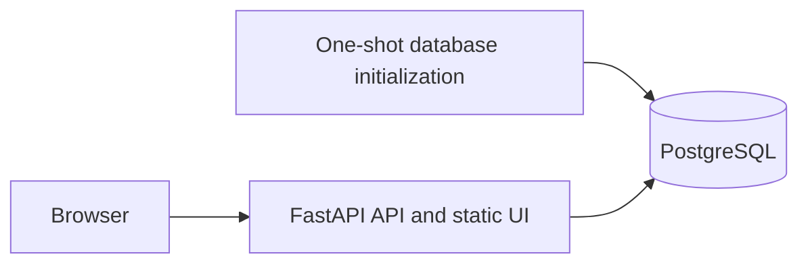

# Offscript Budapest

[](https://github.com/hjarchivenote/offscript-budapest/actions/workflows/ci.yml)

Discover Budapest activities by mood, budget and time, then decide with friends.

Offscript brings coffee, culture, classes, exercise, beauty and wellness into one activity planner. It combines practical discovery filters with a shared shortlist, friend voting and a final choice confirmed by the host.

**Current milestone:** a working English-language application, Docker containerization and verified GitHub Actions CI. The application version is **0.1.0**. Registry publication and Kubernetes delivery are the next infrastructure milestones.


## What the application does

- **Find something that fits:** Today, This weekend or Any day; category, mood, company, energy, budget, activity time, student offers, quiet/study settings, indoors/outdoors and published opening hours.
- **Understand an idea before choosing it:** descriptions, locations, dated events, price and timing notes, source links and explanations of recommendation order.
- **Decide with friends:** create a plan, share its invitation link, suggest activities, vote yes/maybe/no and let the host confirm the final choice. Participation is remembered in the same browser without an account.
- **Contact the provider:** follow the venue's booking, website or WhatsApp link. Appointments and ticket availability are confirmed by the provider.
- **Share an experience:** publish an original review with a rating and visit date. Reviews are submitted by users rather than imported from other platforms.

Every selected discovery filter is required. Ordering uses search relevance, date context and the availability of practical details; it does not invent a match percentage or silently relax filters. “Open now” describes published hours, not available appointments.

## Run locally with Docker

Requires Git, Python 3 and a running Docker Engine with Docker Compose v2. The commands below use a macOS/Linux shell.

```bash
git clone https://github.com/hjarchivenote/offscript-budapest.git
cd offscript-budapest
python3 scripts/prepare_local.py
docker compose up --build --wait
```

Open **[http://localhost:8767](http://localhost:8767)**. The readable API reference is at **[http://localhost:8767/docs](http://localhost:8767/docs)**, with the machine-readable schema at **[http://localhost:8767/openapi.json](http://localhost:8767/openapi.json)**. The reference uses local HTML and CSS and works without external documentation scripts.

The preparation script generates local database passwords under the ignored `.local/` directory and preserves existing passwords. Compose starts PostgreSQL, runs database initialization once, then starts the app. Existing plans and reviews are retained in a named database volume.

```bash
curl --fail http://localhost:8767/health
curl --fail http://localhost:8767/ready
curl --fail http://localhost:8767/version
```

To stop the application while retaining its database:

```bash
docker compose down
```

If port 8767 is occupied, start with `APP_PORT=8768 docker compose up --build --wait` and use port 8768 in the URLs above.

### Run Python without Docker

Requires Python 3.12. After cloning the repository:

```bash
python3.12 -m venv .venv
source .venv/bin/activate
python -m pip install --only-binary=:all: -r requirements.lock -c requirements-runtime.lock
python -m pip check
python run.py
```

Open **[http://localhost:8765](http://localhost:8765)**. This development mode uses SQLite in `.local/offscript.db`; production mode requires shared PostgreSQL. Node.js is needed for the checks below, not to serve the application.

## Architecture

The application uses Python 3.12, FastAPI and SQLAlchemy, with HTML, CSS, JavaScript and original SVG illustrations. PostgreSQL 17 stores the catalogue, plans, participants, votes and reviews in the container setup.



Initialization is separate from app startup. It serializes catalogue changes and preserves historical activity IDs for existing plans and reviews. Production app instances read the initialized database rather than competing to seed it.

Plan mutations lock the shared plan before checking whether it is still open. Two simultaneous final choices produce one winner; a waiting vote or suggestion cannot change an already decided plan. The browser also recovers from stale responses and conflicting changes.

| Endpoint | Purpose |
| --- | --- |
| `GET /api/activities` | Discover and filter activities |
| `GET /api/activities/{activity_id}` | Inspect an activity and its source information |
| `GET/POST /api/activities/{activity_id}/reviews` | Read or publish reviews |
| `POST /api/plans` | Create a plan, optionally including its first suggestion atomically |
| `GET /api/plans/{plan_id}` | View a shared plan |
| `POST /api/plans/{plan_id}/join` | Join with a nickname |
| `POST /api/plans/{plan_id}/candidates` | Suggest an activity compatible with the plan date |
| `PUT /api/plans/{plan_id}/candidates/{candidate_id}/vote` | Cast or change a vote |
| `POST /api/plans/{plan_id}/pick` | Let the host confirm the final choice |
| `GET /health` | Check that the application process responds |
| `GET /ready` | Check database connectivity; return 503 during an outage |
| `GET /version` | Return the app version and build commit |

An invitation link allows anyone who has it to view the plan. Guest identity is stored using an HTTP-only cookie; clearing the cookie loses that browser's participation identity.

## Data and recommendation quality

The authored catalogue contains **152 venues and 172 activities**. Discovery results vary with the selected date and filters.

| Source level | Venues | Activities | What it establishes |
| --- | ---: | ---: | --- |
| Provider-page summaries | 52 | 72 | Details recorded from linked official sources |
| Open-data listings enriched from provider pages | 28 | 28 | Basic identity plus the explicitly checked provider details |
| Basic open-data listings | 72 | 72 | Venue identity and location; prices, hours and suitability remain unconfirmed |

Source URLs and check dates appear in the application. Price and student-offer freshness checks stop expired information from appearing as a current offer or satisfying those filters. Opening calculations use Budapest time, dated exceptions and checked schedules; unknown hours remain distinct from confirmed closures. Conflicting provider information remains unconfirmed rather than becoming a guessed value.

The Overture records retain their identifiers, coordinates and contributor provenance in [open_places.json](app/data/open_places.json). Their [CDLA-Permissive-2.0 licence](app/static/licenses/CDLA-Permissive-2.0.txt) is included. Provider enrichment is recorded in [provider_details.json](app/data/provider_details.json). The UI uses original illustrations, and does not import Google Maps or Tripadvisor reviews or venue photographs.

The data is a curated snapshot. Event dates, venue conditions and availability require ongoing maintenance; it is not a live booking inventory.

## Automated validation

Install the pinned Python dependencies shown above and use **Node.js 24**. Run the same quality command used by GitHub Actions:

```bash
python -u -m scripts.ci quality
```

This runs Ruff, **240 Python tests**, JavaScript syntax checking and **28 JavaScript tests**, installing the pinned Node dependencies along the way. Coverage includes date boundaries, opening and visit windows, commercial freshness, recommendation order, plan permissions, concurrent changes, catalogue updates, API documentation, build-probe cleanup, cache revalidation and failure recovery.

With Docker running, validate a built image against an isolated PostgreSQL database and real browsers:

```bash
python -u -m scripts.ci container
```

The container checks generate isolated test data, exercise two app instances sharing one database, test desktop/mobile browser flows, interrupt and restore the database, and recreate containers to verify persistence. The script removes its disposable Compose project when finished. Chromium and any required browser system dependencies are installed by this command.

Browser checks also cover first-load failures and timeouts, manual and online recovery, preservation of an existing plan during reconnection, original review publication and updating, safe display of submitted HTML, and sharing when clipboard access is denied or unavailable. Copy failures open a selectable link without changing the current page or discarding a draft.

### GitHub Actions

[The CI workflow](.github/workflows/ci.yml) runs on pushes, pull requests and manual dispatch.

| Job | Checks and result |
| --- | --- |
| Quality | Pinned dependencies, linting, Python tests and JavaScript tests |
| Container | Upload-source secret scan, Docker build, Trivy scan, PostgreSQL integration, two-instance concurrency and Playwright browser checks |
| CI gate | Succeeds only if both validation jobs succeed; failures, cancellations and skipped jobs do not count as success |

The image is built for `linux/amd64` and identified by the Git commit. Trivy scans both operating-system and Python packages, blocking HIGH or CRITICAL findings. The source scan blocks detected credentials and retains only sanitized finding locations. Actions and scanner/base images are pinned to commit hashes or digests.

A successful run retains the tested image archive, its SHA-256 checksum and validation metadata. Browser/scan diagnostics and Python test results are retained for troubleshooting. Artifact retention is **7 days**. These are GitHub Actions artifacts; registry publication will be added in the release stage.

**First verified GitHub run:** [CI run 45647384013](https://github.com/hjarchivenote/offscript-budapest/actions/runs/45647384013), for commit [`ea34fd4`](https://github.com/hjarchivenote/offscript-budapest/commit/ea34fd4157a70fe325bea165e2e48fc775abaea8). All three jobs passed, including the 263 automated tests, image scans, browser flows and database recovery checks.

**Failure-path verification:** [Push run 45650479526](https://github.com/hjarchivenote/offscript-budapest/actions/runs/45650479526) and [PR run 45650661254](https://github.com/hjarchivenote/offscript-budapest/actions/runs/45650661254) deliberately fail one test on the verification branch. In both cases the container job is skipped, the final CI gate fails, and no validated image artifact is created. [PR #1](https://github.com/hjarchivenote/offscript-budapest/pull/1) records the failing revision and the corrective change, including browser checks that block all external requests while opening `/docs` and `/redoc`. Registry publication and deployment blocking must also be verified when those stages are implemented.

## Security and troubleshooting

The app container runs as a non-root user with a read-only filesystem, dropped Linux capabilities and a restricted database role. Only the app port is bound to the host's loopback address; PostgreSQL is not published. Passwords are mounted as local Compose secrets and excluded from Git and the image. The app cannot read the database administrator password.

CI also adds temporary, non-secret database/environment/cache sentinels before building, then verifies that all 32 paths are absent from the actual image. This checks the Docker exclusion rules for root and nested application paths. The probe files are removed even when a build fails, preserving existing developer files.

The Compose configuration is a local HTTP preview. An external deployment needs HTTPS, `COOKIE_SECURE=1` and `PUBLIC_ORIGIN` set to its public URL. Cluster and registry credentials belong in protected deployment secrets.

HTML, API and operational responses use `no-store`. Static assets use `no-cache` with ETag revalidation so a reload can pick up a new release without always downloading unchanged assets.

| Symptom | Check |
| --- | --- |
| Docker cannot connect | Start Docker Engine or Docker Desktop before running Compose or the container checks. |
| The first connection fails | Use **Try again** in the connection banner. The app also retries when the connection returns; planning controls stay disabled until initialization finishes. |
| App does not become ready | Run `docker compose ps --all` and `docker compose logs init app db`; initialization must finish and PostgreSQL must be healthy. |
| Password file is missing | Run `python3 scripts/prepare_local.py`. Preserve existing files so they continue to match the persistent database. |
| Few results match a filter | Unknown prices, offers, hours or fixed session lengths cannot satisfy filters that require them. Try a broader search and inspect the source notes. |
| Plan looks out of date | Use **Refresh votes**. A conflict triggers a reload; a failed refresh preserves the last loaded plan and offers a retry. |
| The browser cannot copy a link | Copy the selected address in the **Share this link** dialog. The current plan, page and draft remain in place. |
| A historical event is absent | Expired dated events are excluded from discovery; records remain available for saved plans and reviews. |

## Course requirements and next milestones

This repository is the application and CI foundation for the **End-to-End CI/CD Pipeline with GitHub, Docker, and Kubernetes** assignment. The required release demonstrations are `v1.0.0`, `v1.1.0` and `v1.2.0`; the current `0.1.0` development version precedes them.

| Requirement | Current position and remaining work |
| --- | --- |
| Application and GitHub | Functional app, meaningful API endpoints, health/version endpoints, tests, source repository and this README. PR #1 records the documentation fix and CI verification; the feature-release PR demonstration remains. |
| Docker and registry | Local container execution and automated image validation are implemented. Publish immutable release images to GHCR or Docker Hub. |
| CI | Push validation, scans and the final success gate are verified. PR triggers are configured; add publication restricted to an authorized release branch. |
| Kubernetes | Add and demonstrate a Deployment with at least two replicas, a Service, ConfigMap, Secret, readiness/liveness probes, resource requests/limits and RollingUpdate. |
| Automated delivery | An approved main-branch update must publish a versioned image, deploy it, wait for rollout and verify availability. The deployment runner must be able to reach the chosen cluster securely. |
| Release demonstrations | Show the initial release, a meaningful feature update through a PR and a tested bug-fix release. The CI-only failure example is recorded above; verify that a failing revision is not published or deployed once delivery exists. Record commits, runs, image tags, rollout state and app version for each release. |
| Submission and presentation | Expand the evidence into the required 5-10-page technical PDF and 8-12-slide PowerPoint, and prepare the live change-to-deployment demonstration. |

For a current application walkthrough, launch Compose, filter activities, inspect a provider source, create a plan and join it in another browser to vote. Then open the linked GitHub run to inspect the checks and artifacts. The Kubernetes rollout portion follows once the delivery milestones above are implemented.

European weekend events and travel options remain a possible product expansion after the Budapest planning experience and required delivery pipeline are complete.
