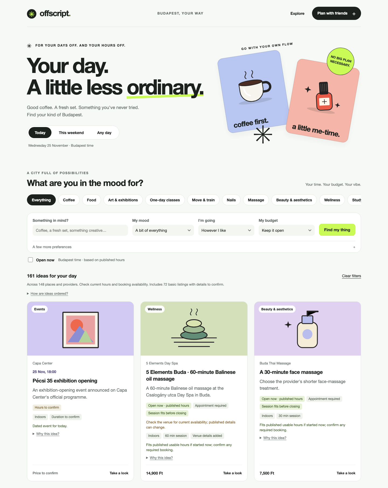
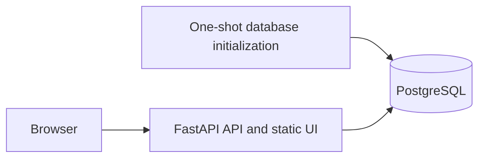

# Offscript Budapest

[](https://github.com/hjarchivenote/offscript-budapest/actions/workflows/ci.yml)

Discover Budapest activities by mood, budget and time, then decide with friends.

Offscript brings coffee, culture, classes, exercise, beauty and wellness into one activity planner. It combines practical discovery filters with a shared shortlist, friend voting and a final choice confirmed by the host.

**Current milestone:** a working English-language application, Docker containerization, GitHub Actions CI, validated-image publication to GitHub Container Registry (GHCR), and continuous deployment into a private local Kubernetes environment. The application version is **0.1.0**. The three required semantic release demonstrations follow next.



## What the application does

- **Find something that fits:** Today, This weekend or Any day; category, mood, company, energy, budget, activity time, student offers, quiet/study settings, indoors/outdoors and published opening hours.
- **Understand an idea before choosing it:** descriptions, locations, dated events, price and timing notes, source links and explanations of recommendation order.
- **Decide with friends:** create a plan, share its invitation link, suggest activities, vote yes/maybe/no and let the host confirm the final choice. Participation is remembered in the same browser without an account.
- **Contact the provider:** follow the venue's booking, website or WhatsApp link. Appointments and ticket availability are confirmed by the provider.
- **Share an experience:** publish an original review with a rating and visit date. Reviews are submitted by users rather than imported from other platforms.

Every selected discovery filter is required. Ordering uses search relevance, date context and the availability of practical details; it does not invent a match percentage or silently relax filters. “Open now” describes published hours, not available appointments.

## Run locally with Docker

Requires Git, Python 3 and a running Docker Engine with Docker Compose v2. The commands below use a macOS/Linux shell.

```bash
git clone https://github.com/hjarchivenote/offscript-budapest.git
cd offscript-budapest
python3 scripts/prepare_local.py
docker compose up --build --wait
```

Open **[http://localhost:8767](http://localhost:8767)**. The readable API reference is at **[http://localhost:8767/docs](http://localhost:8767/docs)**, with the machine-readable schema at **[http://localhost:8767/openapi.json](http://localhost:8767/openapi.json)**. The reference uses local HTML and CSS and works without external documentation scripts.

The preparation script generates local database passwords under the ignored `.local/` directory and preserves existing passwords. Compose starts PostgreSQL, runs database initialization once, then starts the app. Existing plans and reviews are retained in a named database volume.

```bash
curl --fail http://localhost:8767/health
curl --fail http://localhost:8767/ready
curl --fail http://localhost:8767/version
```

To stop the application while retaining its database:

```bash
docker compose down
```

If port 8767 is occupied, start with `APP_PORT=8768 docker compose up --build --wait` and use port 8768 in the URLs above.

### Run Python without Docker

Requires Python 3.12. After cloning the repository:

```bash
python3.12 -m venv .venv
source .venv/bin/activate
python -m pip install --only-binary=:all: -r requirements.lock -c requirements-runtime.lock
python -m pip check
python run.py
```

Open **[http://localhost:8765](http://localhost:8765)**. This development mode uses SQLite in `.local/offscript.db`; production mode requires shared PostgreSQL. Node.js is needed for the checks below, not to serve the application.

## Run locally with Kubernetes

Requires a local Docker Engine and CLI, **kind 0.33.0**, **kubectl 1.37.x** and Python 3.12. The kind node image is pinned in [kind.yaml](k8s/kind.yaml). Use the official [kind installation instructions](https://kind.sigs.k8s.io/docs/user/quick-start/) and [kubectl installation instructions](https://kubernetes.io/docs/tasks/tools/). The helper also detects a kubectl binary installed under `.local/kubernetes/bin`.

Run from the repository root with your local Docker engine selected:

```bash
mkdir -p .local/kubernetes
kind create cluster --name offscript --config k8s/kind.yaml \
  --kubeconfig .local/kubernetes/kubeconfig --wait 120s
python3.12 -m scripts.kubernetes_local
```

Open **[http://localhost:8768](http://localhost:8768)**. A loopback-only kind port mapping reaches the Kubernetes NodePort Service, so the address remains available when app pods are replaced. The separate kubeconfig leaves your global Kubernetes configuration untouched. The helper refuses a remote API server and applies only to the `kind-offscript` context and `offscript` namespace.

| Component | Purpose |
| --- | --- |
| Deployment and Service | Two app replicas, HTTP routing, RollingUpdate with zero unavailable replicas and one surge replica |
| StatefulSet and PVC | One PostgreSQL instance with a 1 GiB persistent volume |
| ConfigMap | Non-sensitive application settings; database initialization SQL is generated from the existing Docker SQL file |
| Secret | Generated passwords mounted as files; the app can read only its restricted database password |
| Initialization Job | Runs catalogue initialization once before the app rollout; its name changes with the image and configuration |
| Probes and resources | Separate startup, readiness and liveness checks, with CPU/memory requests and limits |

Passwords are generated under `.local/kubernetes/secrets`, excluded from Git, and preserved on repeat runs. The cluster Secret is immutable. If an existing cluster Secret differs from the local files, setup stops without replacing its credentials. All app, initialization and database containers run as non-root with read-only root filesystems and dropped capabilities. No service-account token is mounted.

Before changing cluster workloads, the helper executes the pinned image in a disposable, network-isolated Docker container and checks its actual source commit, application version and non-root user. A mismatched or unavailable image stops setup before configuration, credentials, initialization or app replacement. A final per-replica check still confirms the running build.

Rerunning setup resumes an active initialization Job and reuses a successful one. After a terminal failure, it starts a fresh attempt named from the failed Job's identity, preserving the failed attempt for diagnostics until its TTL expires. Failure is reported promptly; correct its cause and rerun the same setup command. A timeout preserves the running Job for the next invocation.

The manifests use a previously published image pinned by digest. To apply another verified image explicitly, pass both its digest and full source commit:

```bash
python3.12 -m scripts.kubernetes_local \
  --image 'ghcr.io/hjarchivenote/offscript-budapest@sha256:<verified-digest>' \
  --commit '<full-source-commit>'
```

The current image is `linux/amd64`. Its execution on an Apple Silicon kind node was verified using Docker Desktop's CPU emulation; the image is not rebuilt locally. A native ARM-only runtime without emulation needs an ARM-compatible image.

Useful checks:

```bash
kubectl --kubeconfig .local/kubernetes/kubeconfig --context kind-offscript \
  -n offscript get pods,services,jobs,pvc
curl --fail http://localhost:8768/ready
curl --fail http://localhost:8768/version
```

This is a single-node local environment with one database instance. The PVC preserves records when a database pod is recreated; deleting the kind cluster removes its local storage. Initial cluster creation is explicit; subsequent approved main updates are delivered by the local worker below.

## Continuous deployment to the private local cluster

The pipeline uses pull-based delivery: GitHub Actions validates and publishes a main revision, then uploads a deployment request containing the image receipt and that revision's Kubernetes configuration. A local worker reads successful main CI results and applies the verified release to the existing cluster. The assignment permits a justified secure deployment mechanism for a private local cluster; this keeps cluster authentication on the local machine and uses outbound HTTPS connections.

After creating the local cluster and installing the pinned development dependencies, keep this command running:

```bash
python -u -m scripts.delivery watch
```

The worker uses the existing Git credential manager for GitHub read access. Alternatively, provide `OFFSCRIPT_GITHUB_TOKEN` through a protected environment with **Actions: read** and **Contents: read** access. Tokens are used in memory and are never written into deployment state, artifacts or source control. The private kubeconfig and generated database passwords remain under `.local/`; they are not uploaded to GitHub. Public GHCR images need no registry password.

Merge an approved change to `main`. After all validation and publication jobs succeed, the worker:

1. Confirms the current main commit, repository, workflow, event and CI attempt, including every required job's success.
2. Verifies the GitHub artifact digest, publication receipt and hashes of the allowlisted configuration files. Only deployment data is accepted; downloaded scripts are not executed.
3. Validates API schemas and deployment safeguards, verifies the pinned image, and rechecks main/CI immediately before changing workloads.
4. Initializes the catalogue, applies the configuration and rolls both app replicas to the image digest from that CI run.
5. Waits for rollout completion and checks readiness, the Service address and the running commit/version. It records success or failure locally.

```bash
python -m scripts.delivery status
curl --fail http://localhost:8768/version
```

Status includes whether the worker is running, the desired commit, the source CI URL and the last successful deployment. `.local/delivery/events.jsonl` records transitions; the matching `rollout-<commit>-<attempt>.json` records both replicas and their versions. These files contain no credentials. CI success means a validated release request is available; local deployment success is confirmed by the worker's status and rollout record.

The worker checks every 15 seconds by default, serializes deployment with a local lock, resumes interrupted setup and avoids redeploying an already healthy release. Failed or cancelled CI, pull requests, other branches, stale main revisions/attempts and invalid artifacts cannot initiate deployment. Failures retain the previous success record and retry with bounded backoff; this is not automatic rollback. Correct main and let the worker retry, or stop the worker before manually restoring a previously verified image/configuration.

Docker, the cluster and this worker must be running. After a restart, rerun the watch command; while the machine is asleep or offline, deployment waits until connectivity returns. Requests expire after the existing seven-day artifact retention period; rerun main CI to create a fresh request. The local worker intentionally holds no GitHub write permission.

## Architecture

The application uses Python 3.12, FastAPI and SQLAlchemy, with HTML, CSS, JavaScript and original SVG illustrations. PostgreSQL 17 stores the catalogue, plans, participants, votes and reviews in the container setup.



Initialization is separate from app startup. It serializes catalogue changes and preserves historical activity IDs for existing plans and reviews. Production app instances read the initialized database rather than competing to seed it.

Plan mutations lock the shared plan before checking whether it is still open. Two simultaneous final choices produce one winner; a waiting vote or suggestion cannot change an already decided plan. The browser also recovers from stale responses and conflicting changes.

| Endpoint | Purpose |
| --- | --- |
| `GET /api/activities` | Discover and filter activities |
| `GET /api/activities/{activity_id}` | Inspect an activity and its source information |
| `GET/POST /api/activities/{activity_id}/reviews` | Read or publish reviews |
| `POST /api/plans` | Create a plan, optionally including its first suggestion atomically |
| `GET /api/plans/{plan_id}` | View a shared plan |
| `POST /api/plans/{plan_id}/join` | Join with a nickname |
| `POST /api/plans/{plan_id}/candidates` | Suggest an activity compatible with the plan date |
| `PUT /api/plans/{plan_id}/candidates/{candidate_id}/vote` | Cast or change a vote |
| `POST /api/plans/{plan_id}/pick` | Let the host confirm the final choice |
| `GET /health` | Check that the application process responds |
| `GET /ready` | Check database connectivity; return 503 during an outage |
| `GET /version` | Return the app version and build commit |

An invitation link allows anyone who has it to view the plan. Guest identity is stored using an HTTP-only cookie; clearing the cookie loses that browser's participation identity.

## Data and recommendation quality

The authored catalogue contains **152 venues and 172 activities**. Discovery results vary with the selected date and filters.

| Source level | Venues | Activities | What it establishes |
| --- | ---: | ---: | --- |
| Provider-page summaries | 52 | 72 | Details recorded from linked official sources |
| Open-data listings enriched from provider pages | 28 | 28 | Basic identity plus the explicitly checked provider details |
| Basic open-data listings | 72 | 72 | Venue identity and location; prices, hours and suitability remain unconfirmed |

Source URLs and check dates appear in the application. Price and student-offer freshness checks stop expired information from appearing as a current offer or satisfying those filters. Opening calculations use Budapest time, dated exceptions and checked schedules; unknown hours remain distinct from confirmed closures. Conflicting provider information remains unconfirmed rather than becoming a guessed value.

The Overture records retain their identifiers, coordinates and contributor provenance in [open_places.json](app/data/open_places.json). Their [CDLA-Permissive-2.0 licence](app/static/licenses/CDLA-Permissive-2.0.txt) is included. Provider enrichment is recorded in [provider_details.json](app/data/provider_details.json). The UI uses original illustrations, and does not import Google Maps or Tripadvisor reviews or venue photographs.

The data is a curated snapshot. Event dates, venue conditions and availability require ongoing maintenance; it is not a live booking inventory.

## Automated validation

Install the pinned Python dependencies shown above and use **Node.js 24**. Run the same quality command used by GitHub Actions:

```bash
python -u -m scripts.ci quality
```

This runs Ruff, **333 Python tests**, JavaScript syntax checking and **28 JavaScript tests**, installing the pinned Node dependencies along the way. Nine opt-in Kubernetes integration cases are skipped here and run in the dedicated CI job below. Coverage includes date boundaries, opening and visit windows, commercial freshness, recommendation order, plan permissions, concurrent changes, catalogue updates, API documentation, build-probe cleanup, cache revalidation, publication safeguards, local cluster target/credential protection, image preflight, initialization recovery, delivery eligibility, artifact tampering and stale-release blocking.

For a running application cluster, validate manifests without changing workloads:

```bash
python -m scripts.check_kubernetes
```

The opt-in integration suite requires a validated current-image archive, the matching full commit and the separate `kind-offscript-ci` context; it cannot fall back to an older published image or run candidate images in the application cluster. It verifies both running image IDs, Service routing, initialization recovery and rejection of incorrect configuration. The CI cluster uses loopback port **8769**; the application remains on **8768**.

With Docker running, validate a built image against an isolated PostgreSQL database and real browsers:

```bash
candidate_commit="$(git rev-parse HEAD)"
python -u -m scripts.ci container --image "offscript:ci-$candidate_commit" --commit "$candidate_commit"
```

The container checks generate isolated test data, exercise two app instances sharing one database, test desktop/mobile browser flows, interrupt and restore the database, and recreate containers to verify persistence. The script removes its disposable Compose project when finished. Chromium and any required browser system dependencies are installed by this command.

To run the same current-image Kubernetes handoff locally after that command:

```bash
(
set -e
python -m scripts.kubernetes_image config
kind create cluster --name offscript-ci --config .local/ci/kind-ci.yaml \
  --kubeconfig .local/ci/kubeconfig --wait 120s
trap 'kind delete cluster --name offscript-ci --kubeconfig .local/ci/kubeconfig' EXIT
kubectl --kubeconfig .local/ci/kubeconfig --context kind-offscript-ci apply -f k8s/namespace.yaml
export CI_COMMIT_SHA="$candidate_commit"
export OFFSCRIPT_KUBERNETES_TEST_CONFIG="$PWD/.local/ci/kubeconfig"
export OFFSCRIPT_KUBERNETES_IMAGE_DIR="$PWD/.local/ci"
python -m scripts.kubernetes_image load
python -m pytest -q tests/test_kubernetes_integration.py --junitxml=.local/ci/kubernetes-tests.xml
python -m scripts.kubernetes_image receipt
)
```

The subshell stops on failure and removes only its test cluster on exit. Kubernetes credentials and synthetic database passwords for this check are separate from the running application's files. No registry publication is needed to test a candidate.

Browser checks also cover first-load failures and timeouts, manual and online recovery, preservation of an existing plan during reconnection, original review publication and updating, safe display of submitted HTML, and sharing when clipboard access is denied or unavailable. Copy failures open a selectable link without changing the current page or discarding a draft.

Delayed review and suggestion responses cannot reopen a closed detail dialog, replace a different activity or erase a newer review draft. A saved review updates its own list entry, including an older review outside the 100-item display window; failed saves retain the form for retry, and background failures remain visible after a dialog is closed or replaced. Concurrent edits write a complete submission atomically, verified both with coordinated request snapshots and with two real PostgreSQL-backed app instances.

### GitHub Actions

[The CI workflow](.github/workflows/ci.yml) runs on pushes, pull requests and manual dispatch.

| Job | Checks and result |
| --- | --- |
| Quality | Pinned dependencies, linting, Python tests and JavaScript tests |
| Container | Upload-source secret scan, Docker build, Trivy scan, PostgreSQL integration, two-instance concurrency and Playwright browser checks |
| Kubernetes | Runs after Container, retrieves that job's exact image archive, verifies its checksum/image ID, loads it into isolated kind with `imagePullPolicy: Never`, and checks schemas, safeguards, both running image IDs, Service routing and recovery |
| CI gate | Succeeds only if all three validation jobs succeed; failures, cancellations and skipped jobs do not count as success |
| Publish | Runs only after all four preceding jobs succeed on a push to `main`; publishes and pull-verifies the checked image, then uploads a deployment request bound to that run/attempt |

Container and Kubernetes test the same current-revision image without rebuilding or publishing it between stages. The Kubernetes receipt binds the commit, version, archive checksum, both runtime image IDs and unskipped test results to the CI run/attempt. Each replica's image identity comes from its running container's CRI status, so synthetic archive-import names cannot break the lookup. Publication rejects a missing or mismatched receipt before registry authentication; the delivery package validates the same evidence again. Every Kubernetes CI run has a private kubeconfig and disposable cluster derived from `kind.yaml`, with a separate port and database credentials.

The image is built and exported for `linux/amd64` and identified by the Git commit. Container/archive checks require Docker 28 or newer. Receipt image IDs are canonical OCI configuration digests; Docker may display an index or manifest ID, so validation also matches runtime configuration and filesystem layers instead of equating different identifier formats. Trivy scans both operating-system and Python packages, blocking HIGH or CRITICAL findings. The source scan blocks detected credentials and retains only sanitized finding locations. Actions and scanner/base images are pinned to commit hashes or digests.

A successful run retains the tested image archive, its SHA-256 checksum, validation metadata and a `kubernetes-validated-image-<commit>` receipt. Browser/scan diagnostics and Python/Kubernetes test results are retained for troubleshooting. Artifact retention is **7 days**. Main-branch runs also retain a `published-image-<commit>` artifact containing the registry reference, matching Kubernetes evidence and publication receipt.

### Published images

The registry is **`ghcr.io/hjarchivenote/offscript-budapest`**. Each successful main-branch push publishes a `sha-<full Git commit>` tag. PRs, other branches and manual validation runs do not publish. Only the publication job receives `packages: write`, using GitHub's short-lived `GITHUB_TOKEN`; no personal registry password is stored in the repository.

Publication downloads the image archive from the **same workflow run**, checks its archive checksum, commit, version, scan/check metadata and loaded image ID, then pushes it without rebuilding. It removes the local app tags, pulls the registry image by digest, checks the image ID again and runs a non-root version/commit smoke check. A failure produces no successful publication receipt.

The workflow summary and `published-image-<commit>` artifact record the full `registry_reference`, for example `ghcr.io/hjarchivenote/offscript-budapest@sha256:<digest>`. Use that recorded digest for deployments: registry tags can be replaced on a rerun, while a digest identifies exact image content. The current images are `linux/amd64`; the required `v1.0.0`, `v1.1.0` and `v1.2.0` release demonstrations remain to be performed through continuous deployment.

To run a published image, copy its actual digest reference from a successful main workflow into `OFFSCRIPT_IMAGE`, then use the existing Compose setup without rebuilding:

```bash
export OFFSCRIPT_IMAGE='ghcr.io/hjarchivenote/offscript-budapest@sha256:<digest-from-publication-receipt>'
python3 scripts/prepare_local.py
docker pull --platform linux/amd64 "$OFFSCRIPT_IMAGE"
DOCKER_DEFAULT_PLATFORM=linux/amd64 docker compose up --no-build --wait
```

This repository's published image is publicly pullable without signing in. The [first publication run](https://github.com/hjarchivenote/offscript-budapest/actions/runs/45770266678) verified an authenticated digest pull; anonymous registry access was also checked against the same digest and image config ID. GHCR controls package visibility separately from repository visibility. Private packages require registry authentication with read access.

**First verified GitHub run:** [CI run 45647384013](https://github.com/hjarchivenote/offscript-budapest/actions/runs/45647384013), for commit [`ea34fd4`](https://github.com/hjarchivenote/offscript-budapest/commit/ea34fd4157a70fe325bea165e2e48fc775abaea8). All three jobs passed, including the 263 automated tests, image scans, browser flows and database recovery checks.

**Failure-path verification:** [Push run 45650479526](https://github.com/hjarchivenote/offscript-budapest/actions/runs/45650479526) and [PR run 45650661254](https://github.com/hjarchivenote/offscript-budapest/actions/runs/45650661254) deliberately fail one test on the verification branch. In both cases the container job is skipped, the final CI gate fails, and no validated image artifact is created. [PR #1](https://github.com/hjarchivenote/offscript-budapest/pull/1) records the failing revision and the corrective change, including browser checks that block all external requests while opening `/docs` and `/redoc`. [PR #5](https://github.com/hjarchivenote/offscript-budapest/pull/5) adds current publication-blocking evidence: the failed revision produces no release artifacts or registry tag, and recovery runs the identical dependency gate through a read-only positive control. Main and its published image remain unchanged. Delivery eligibility tests reject failed/cancelled CI and prevent any apply; repeat the end-to-end failing-revision demonstration with delivery running as part of the required release demonstrations.

## Security and troubleshooting

The app container runs as a non-root user with a read-only filesystem, dropped Linux capabilities and a restricted database role. Only the app port is bound to the host's loopback address; PostgreSQL is not published. Passwords are mounted as local Compose secrets and excluded from Git and the image. The app cannot read the database administrator password.

CI also adds temporary, non-secret database/environment/cache sentinels before building, then verifies that all 32 paths are absent from the actual image. This checks the Docker exclusion rules for root and nested application paths. The probe files are removed even when a build fails, preserving existing developer files.

The Compose configuration is a local HTTP preview. An external deployment needs HTTPS, `COOKIE_SECURE=1` and `PUBLIC_ORIGIN` set to its public URL. Cluster and registry credentials belong in protected deployment secrets.

HTML, API and operational responses use `no-store`. Static assets use `no-cache` with ETag revalidation so a reload can pick up a new release without always downloading unchanged assets.

| Symptom | Check |
| --- | --- |
| Docker cannot connect | Start Docker Engine or Docker Desktop before running Compose or the container checks. |
| The first connection fails | Use **Try again** in the connection banner. The app also retries when the connection returns; planning controls stay disabled until initialization finishes. |
| App does not become ready | Run `docker compose ps --all` and `docker compose logs init app db`; initialization must finish and PostgreSQL must be healthy. |
| Password file is missing | Run `python3 scripts/prepare_local.py`. Preserve existing files so they continue to match the persistent database. |
| Few results match a filter | Unknown prices, offers, hours or fixed session lengths cannot satisfy filters that require them. Try a broader search and inspect the source notes. |
| Plan looks out of date | Use **Refresh votes**. A conflict triggers a reload; a failed refresh preserves the last loaded plan and offers a retry. |
| The browser cannot copy a link | Copy the selected address in the **Share this link** dialog. The current plan, page and draft remain in place. |
| A historical event is absent | Expired dated events are excluded from discovery; records remain available for saved plans and reviews. |

## Course requirements and next milestones

This repository implements the application, CI, registry publication, local Kubernetes and continuous deployment stages for the **End-to-End CI/CD Pipeline with GitHub, Docker, and Kubernetes** assignment. The required release demonstrations are `v1.0.0`, `v1.1.0` and `v1.2.0`; the current `0.1.0` development version precedes them.

| Requirement | Current position and remaining work |
| --- | --- |
| Application and GitHub | Functional app, meaningful API endpoints, health/version endpoints, tests, source repository and this README. PR #1 records the documentation fix and CI verification; the feature-release PR demonstration remains. |
| Docker and registry | Local container execution, image validation and main-only GHCR publication with a digest and pull verification are implemented. Add the required semantic release tags alongside the Kubernetes demonstrations. |
| CI | Push/PR validation, scans and the final success gate are verified. Publication depends on every validation job succeeding and is restricted to pushes to `main`. |
| Kubernetes | Local kind environment with two app replicas, Service, ConfigMap, generated Secret, separate readiness/liveness probes, resource requests/limits, RollingUpdate and persistent PostgreSQL. |
| Automated delivery | Successful main CI produces a verified deployment request. The outbound-only local worker applies its image/configuration, waits for rollout, checks Service availability and records the running version. |
| Release demonstrations | Show the initial release, a meaningful feature update through a PR and a tested bug-fix release. The CI-only failure example is recorded above; verify that a failing revision is not published or deployed once delivery exists. Record commits, runs, image tags, rollout state and app version for each release. |
| Submission and presentation | Expand the evidence into the required 5-10-page technical PDF and 8-12-slide PowerPoint, and prepare the live change-to-deployment demonstration. |

For a current application walkthrough, launch Compose or the local Kubernetes environment, filter activities, inspect a provider source, create a plan and join it in another browser to vote. For delivery, keep the local worker running, merge a change, inspect its successful GitHub run and deployment request, then show worker status, both replicas and `/version`. The three required semantic release demonstrations remain.

European weekend events and travel options remain a possible product expansion after the Budapest planning experience and required delivery pipeline are complete.
